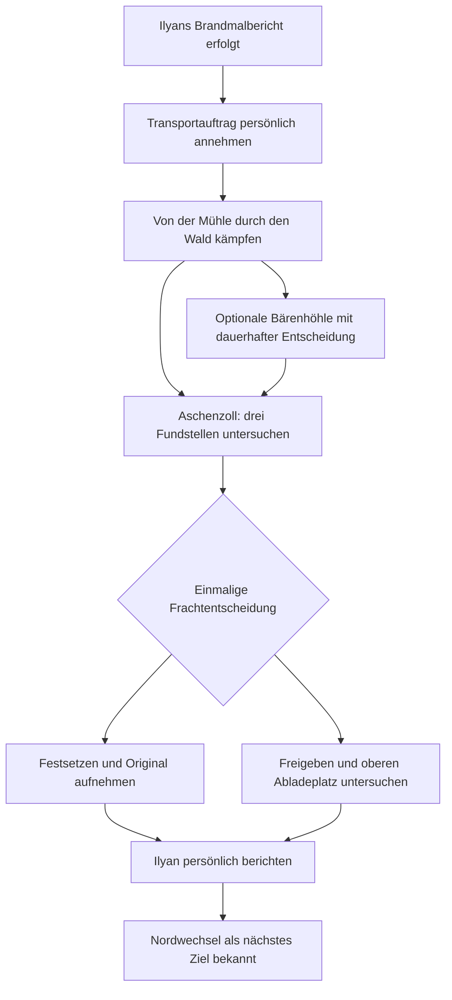

# Aschenzoll — die Transportspur nach Immergrün

Stand: 13.11.2026. **Story- und Umsetzungsentwurf, noch nicht implementiert.**

Der Owner hat als nächsten Abschnitt nach Ilyans Brandmalbericht ausdrücklich **„Handelsstation und Transportspur“** gewählt. „Aschenzoll“, „Nordwechsel“, die folgenden Fundstücke und die Frachtentscheidung sind konkrete Vorschläge innerhalb dieser Richtung, noch keine bestätigten historischen Weltfakten. Ursprünglicher Quellstand: `36d5b2d485d2be2e97aae1804c9fe0cf62c4d5f0`; am 13.11. aktualisiert nach PR28-Merge und der Owner-Entscheidung für Dungeon, Waldweg und Bärenhöhle. Der isolierte AC13-Ankunftsversuch ist geparkt und kein Bestandteil dieses Entwurfs.

## Was der Abschnitt erzählen soll

Unterhalb Immergrüns liegt eine kleine Handelsstation: oben ziehen Waren weiter zum grünen Berg, unten warten Menschen zwischen leeren Karren und Asche. Der Spieler untersucht einen ausgehenden Rücktransport. Ein beschädigter Tierkäfig und sein Frachtbeleg verbinden die Gegend der alten Mühle mit einem weiteren Umschlagplatz. Die Spur wird geografisch greifbar; die Verantwortlichen bleiben unbekannt.

Am Ende steht ein konkretes Ziel: **der Nordwechsel**, ein weiterer Umschlagpunkt auf dem Weg nach Immergrün. Er wird benannt, aber in diesem Block noch nicht begehbar. Der Spieler bringt Ilyan entweder den gesicherten Originalbeleg oder einen Bericht über den tatsächlich beobachteten Transport. Kein weiterer Rattlerkampf ist erforderlich.

## Verbindlicher Ausgangspunkt

- [Rattler und Immergrün](RATTLER_IMMERGRUEN.md): Das Halsbrandmal entspricht dem königlichen Wappen. Es beweist weder einen persönlichen Königsbefehl noch einen bestimmten Abrichter oder Zielgeruch.
- Erst `CharacterProgression.Rattler.Reported` bestätigt das persönliche Gespräch mit Ilyan. Brandmaluntersuchung allein eröffnet diesen Auftrag nicht.
- [Kryptaermittlung](CRYPT_INVESTIGATION.md): Das Schicksal der Vermissten bleibt offen. Auch der fehlende Mühlenpatient wird hier nicht nachträglich identifiziert.
- Immergrün liegt hoch auf einem Berg. Seine schwebende Erscheinung ist kein Nachweis eines tatsächlich fliegenden Landes. Handelszugang und Wohnrecht sind verschieden.
- Die bisherigen Vorratsentscheidungen, individuellen NPC-Erinnerungen und Patienten bleiben erhalten. Mara und Dorn erfahren durch einen Bericht an Ilyan nichts automatisch.
- Das Brandmal bleibt ein Lore-Hinweis. Dieser Abschnitt braucht weder ein neues Tattoo-Modell noch eine festgelegte heraldische Zeichnung.

## Spielablauf und Texte

### 1. Ilyan weist zum Handelsweg

Nach dem bereits erfolgten Brandmalbericht erscheint bei Ilyan eine neue, freiwillige Handlung: **„Nach den Transportwegen fragen“**. Sie verlangt dasselbe reale, erreichbare Gespräch wie der bisherige Bericht. Kein automatischer Gebietswechsel.

> „Wenn dieses Tier hierhergebracht wurde, musste jemand Platz dafür schaffen. Unter Immergrün wird jede Last umgeschlagen. Am Aschenzoll könnten noch Spuren sein. Aber ein Wappen verrät uns nicht, wer die Fracht bestellt hat.“

Neues Ziel: **„Untersuche die Rückfracht am Aschenzoll.“** Die Annahme weist zum Handelsweg an der alten Mühle. Von dort führt ein eigener, begehbarer Waldabschnitt zur Station. Dorf, Aschestraße und Mühle bleiben die Rückroute zu Ilyan. Es gibt keinen direkten Dorf–Stationssprung.

### 2. Der Waldweg und die Bärenhöhle

Zwischen Mühle und Aschenzoll liegt eine Kampf- und Erkundungsstrecke mit verzweigten Wald-/Buschwegen, Gegnern, optionalen Truhen und ein bis zwei Nebenaufgaben. Der zuvor entwickelte Dungeon besitzt drei prozedurale Ebenen und einen erneut farmbaren Rattler; seine Storyentdeckungen bleiben abgeschlossen. Der Wald erhält passende eigene Raum-/Wegbausteine und feste, erreichbare Questorte. Ein Generatorsystem allein ersetzt weder Gegnerbalance noch Landschaftsgestaltung.

In einer abzweigenden Höhle leben die Jungen der Bärin vom Jägerereignis. Die Quest liest den tatsächlichen Zustand von Bärin und Jäger; sie erfindet keinen Tod der Mutter. Zwei bewusste Entscheidungen tragen verschiedene Folgen:

- Junge töten und häuten: einmalige Felle; eine besondere Rüstung muss anschließend tatsächlich hergestellt werden.
- Junge verschonen und Schutz organisieren: persönlicher Bericht im Dorf und zugesagter Schutz werden eigene gespeicherte Fakten. Daraus kann später eine Fraktion Kriegsbären für den Kampf um die Herrschaftstürme gewinnen.

Vier Fraktionen gehören zum geplanten Endgame. Fraktionsnamen, begünstigte Fraktion, Rüstungswerte und Stärke des Vorteils sind offen. Ein neuer Farmrun darf weder die Entscheidung zurücksetzen noch erneut Felle aus derselben Storybegegnung erzeugen. Verschonen allein ist noch kein organisierter Schutz. Diese Quest und der Wald sind noch nicht implementiert.

### 3. Die Station lesen

Drei kurze, aus der Nähe untersuchbare Punkte vermitteln unterschiedliche Fakten. Ihre Reihenfolge ist frei; alle drei werden vor der endgültigen Entscheidung benötigt.

| Fundstelle | Sichtbarer Inhalt / Untersuchungstext | Zulässige Schlussfolgerung |
| --- | --- | --- |
| Aushang am Zugang | „Handel bis zum Schlusszeichen. Aufenthalt oberhalb der Station nur mit Wohnrecht oder Erlaubnis.“ | Die bekannte Ausgrenzung Immergrüns prägt auch diesen Handelsweg. Kein Echtzeit-Tagesablauf wird eingeführt. |
| Offener Rückfrachtkäfig | Leer, schwere Beschläge, von innen beschädigte Querstreben; am Rahmen steht dieselbe Sendungsnummer wie auf dem Beleg. | Hier wurde ein großes Tier transportiert. Die Schäden passen zum Verdacht, identifizieren aber nicht zweifelsfrei den Rattler. Keine Gefangenen im ausgehenden Käfig. |
| Frachtpult | „Sendung 17. Lebendfracht: eine Einheit. Abladeort: Alte Mühle. Leerbehälter zurück über Aschenzoll. Weitergabe: Nordwechsel.“ Auftraggeberfeld fehlt auf diesem Abschnitt. | Der dokumentierte Transportweg berührt die Mühle; Nordwechsel ist der nächste überprüfbare Ort. „Eine Einheit“ identifiziert weder Mensch noch vermissten Patienten. |

Die Sendungsnummer ist ein lokales Zuordnungsmerkmal, kein neu eingeführtes königliches Siegel. Das Lesen merkt den Inhalt; das spätere Sichern des Originals ist ein eigener Weltzustand. Der Spieler darf nach jedem Fund zurückkehren, ohne Wissen zu verlieren.

### 4. Begegnung am Frachtpult

Ein **örtlicher Frachtwächter** hält den Spieler vom gesperrten Arbeitsbereich fern. Seine Zugehörigkeit zum Königshaus wird nicht behauptet. Kurzer Zuruf: „Zurück vom Pult. Diese Fracht geht weiter.“ Erst das Betreten des sichtbar abgegrenzten Bereichs beginnt die Begegnung.

Vorgeschlagen ist ein einzelner Nahkampfgegner mit klar angekündigtem Hieb und begrenztem Verfolgungsbereich. Bestehende Bewegung und Fähigkeiten gelten. Der Spieler kann ihn besiegen oder aus seiner Position locken und die Untersuchung abschließen; ein Kill ist keine Questbedingung. Dafür müssen Wegbreiten, Angriffspausen und Interaktionsdauer im echten Spiel überprüft werden. Keine neue allgemeine Fraktions-, Bestechungs- oder Tarnmechanik.

Der Wächter verfolgt nicht ins Dorf. Rückzug bleibt möglich. Ein besiegter Wächter bleibt besiegt, seine etwaige normale Kampfbelohnung wird nur einmal vergeben. Für die Entscheidung selbst gibt es in diesem Block keine neue XP- oder Gegenstandsbelohnung.

### 5. Eine informierte Frachtentscheidung

Am Bedienpult sind nach den drei Untersuchungen beide Möglichkeiten mit ihren unmittelbaren Folgen sichtbar. Keine verdeckte Frist. Die Fracht beginnt erst nach einer bewussten Wahl zu rollen.

| Handlung | Hinweis vor dem Auslösen | Unmittelbare, gespeicherte Folge | Ergebnis für Ilyan |
| --- | --- | --- | --- |
| **„Fracht festsetzen — Beleg sichern“** | „Der Notriegel blockiert diese Abfahrt. Käfig und Originalbeleg bleiben hier; den tatsächlichen Abladeplatz wirst du so nicht verfolgen.“ | Der einmalige Notriegel verkeilt die beladene Plattform. Der Spieler nimmt anschließend am Pult den Originalbeleg auf. Käfig und Plattform bleiben sichtbar am Start. | Originalbeleg vorhanden; der Nordwechsel ist dokumentiert, die aktuelle Weiterfahrt nicht beobachtet. |
| **„Rückfracht freigeben — Weg verfolgen“** | „Der leere Käfig fährt mit dem Originalbeleg zum oberen Abladeplatz. Folge ihm, um seine dortige Zuordnung zu prüfen.“ | Der Beleg wird mit der Sendung verschlossen; der leere Käfig fährt innerhalb dieser Region auf einer festen Bahn zur oberen Rampe. Dort bleibt er stehen. Der Spieler untersucht dort Sendungsnummer und Abladezeichen. | Tatsächlich am oberen Platz vorgefundene Sendung mit Zuordnung zum Nordwechsel; kein Originalbeleg im Besitz. |

Die Wahl entscheidet über **Beweissicherung oder überprüfte Weitergabe**, nicht über eine behauptete Rettung unbekannter Insassen. Sie legt auch nicht die politische Loyalität des Spielers fest. Keine versteckten Rufwerte oder versprochenen späteren Boni.

Die Frachtbahn selbst ist nicht begehbar. Ein dauerhafter seitlicher Fußweg verbindet beide Rampen und den Rückweg; die blockierte Plattform kann den Spieler nicht einsperren. Der Notriegel lässt sich in diesem Abschnitt nicht reparieren. Nach Freigabe ist der Riegel gesperrt. Die erste gültige Wahl gilt nach Reise, Tod und Laden weiterhin; Eingabewiederholung darf niemals beide Ergebnisse erzeugen.

Bei Freigabe bewegt allein der Core die Fracht mit festen 100-ms-Schritten. Außerhalb dieser Region pausiert sie, bei geschlossener App vergeht keine Simulationszeit. Ankunft allein zählt nicht als Untersuchung. Wer weggeht oder stirbt, kann zurückkehren und den abgestellten Käfig noch prüfen; kein zeitabhängiger Verlust der Spur. Das Öffnen des verschlossenen Begleitfachs ist keine zusätzliche Handlung dieses Abschnitts.

### 6. Persönlicher Abschluss bei Ilyan

Nach dem tatsächlichen Sichern beziehungsweise der Untersuchung an der oberen Rampe: **„Bringe Ilyan die Transportspur.“** Ein erfolgreicher Bericht benötigt Ilyan vor Ort und die bestehenden Gesprächsvoraussetzungen. Fehlt der Kontakt, bleiben Beweis und Rückweg erhalten; kein automatischer Abschluss.

Mit Originalbeleg:

> „Alte Mühle. Nordwechsel. Jetzt haben wir eine Strecke auf Papier. Ob darin dein Tier saß, wissen wir noch nicht. Aber wir wissen, an welcher Übergabe wir als Nächstes fragen müssen.“

Mit überprüfter Weitergabe:

> „Dieselbe Sendung an der oberen Rampe, dem Nordwechsel zugeordnet. Du hast geprüft, wohin der Rücktransport geführt wird. Wer ihn bestellt hat, steht damit noch immer nicht fest.“

Abschlussziel: **„Die Spur führt zum Nordwechsel. Der weitere Weg ist noch nicht zugänglich.“** Keine funktionslose Reisemöglichkeit zum Folgegebiet. Beide Varianten bleiben im Journal unterscheidbar. Ilyan erhält nur die persönlich gemeldeten Tatsachen; frühere Vorratsentscheidungen und Beziehungen werden nicht überschrieben.

## Gebiet und Darstellung

Ein kompakter Außenbereich nach dem neuen Waldweg. Regionkennungen werden bei Integration explizit vergeben; die Station beansprucht nicht vorab Akt 8. Die folgenden Millimeterkoordinaten sind ein **Blockout-Vorschlag**, keine verifizierte Laufkarte:

| Punkt | X / Z (mm) | Funktion |
| --- | --- | --- |
| Rückweg in den Wald | 0 / -24000 | Sicherer Ausgang, dauerhaft verfügbar |
| Ankunft | 0 / -21000 | Außerhalb des sofortigen Rückreiseauslösers |
| Aushang | -5000 / -14000 | Orientierung vor dem Konfliktbereich |
| Käfig / untere Rampe | 4000 / -4000 | Untersuchung, Start der Frachtbahn |
| Frachtpult / Notriegel | -3000 / 0 | Begegnung und Entscheidung |
| Obere Rampe | 4000 / 14000 | Ende der Frachtbewegung, zweite Untersuchung |
| Seitlicher Fußweg | Korridor um X = -9000 | Erreichbarer Weg an beiden Rampen vorbei |

Die neue Verbindung lautet **Mühle ↔ Waldweg ↔ Aschenzoll**, mit einem Abzweig **Waldweg ↔ Bärenhöhle**. Ausgänge und sichere Ankünfte müssen beim Wald-Blockout gemeinsam festgelegt und mit echter Bewegung geprüft werden. Die bestehenden Dorf-/Straßen-/Mühlenkanten bleiben erhalten. Der alte Vorschlag eines östlichen Dorfabzweigs zur Station entfällt.

Holz, Stein, Warenstapel und aschiger Boden können auf dem vorhandenen Materialbestand aufbauen. Käfig und Mechanik brauchen erkennbare eigene Formen; ein unpassendes vorhandenes Modell gilt nicht allein durch Umbenennung als fertig. Private Modelle nur als separate passive Bindungen, keine Rohassets im Repository. Die obere Bergsilhouette darf Immergrün andeuten; kein begehbares Schloss und keine neue Schwebemechanik. Fables Kamera und Bedienstruktur bleiben erhalten.

## Core, Reisen und Speichern

Ein vorgeschlagener `TradeRouteEncounter` gehört zu `CharacterProgression`. Er besitzt Annahme, Fundbits, Entscheidung, Frachtfortschritt, Beweisaufnahme, Bericht und Begegnungszustand. Unity zeigt diese Werte und sendet Handlungen über die vorhandene Eingabewarteschlange; Animation, Collider und Renderzeit entscheiden keine Fakten.

Reisen sind an jedem aktiven Schritt möglich; die Grafik zeigt nur den Fortschritt, keinen Zwangspfad. Abgeleitete Zustände sind vorzuziehen: „berichtsfähig“ ergibt sich aus Entscheidung und zugehörigem Beweis, nicht aus einem unabhängig setzbaren Flag.

### Bekannte Integrationsstellen am Quellstand

| Bestehende Stelle | Nötige Änderung / Grenze |
| --- | --- |
| [HungerJourney.cs](../Assets/Scripts/Core/HungerJourney.cs): `TraverseHunger`, `AtAnyPassage` | Benannte Übergänge mit explizitem Ziel und Ankunft ergänzen. `EntryAct +/- 1` bildet Waldabzweig, Höhle und Station nicht ab. Die alten Nord-/Südkanten bleiben gleich. |
| [ArpgSimulation.cs](../Assets/Scripts/Core/ArpgSimulation.cs): `TryTraversePassage` und Spawn | Reise übernimmt weiter HP, Fokus und Cooldowns. Neue Abzweigankunft nicht über das bisherige Nord-/Süd-Bool vortäuschen. Spawn außerhalb von Hindernissen und Reiseauslösern validieren. |
| `HungerJourney.TravelHunger`, Core-Kollision und [ArenaRuntime.cs](../Assets/Scripts/Runtime/ArenaRuntime.cs): `BuildChapterScenery` | Numerische Bereichsprüfungen wie `act >= 5` klassifizieren den neuen Akt sonst als Krypta. Region explizit zuordnen; gemeinsame Stationsgeometrie für Core und Darstellung. |
| `HungerAction` und Aktionsdispatch | Bestehende numerische Bereiche leiten hohe Werte an den Rattler weiter. Eigene explizite Dispatch-Zuordnung für Stationshandlungen, bestehende Werte stabil lassen. |
| [CryptInvestigation.cs](../Assets/Scripts/Core/CryptInvestigation.cs) und [RattlerEncounter.cs](../Assets/Scripts/Core/RattlerEncounter.cs) | Neues aktives Ziel nach Annahme vor dem bisherigen abschließenden Rattlertext anzeigen; alte Journalfakten weiter erhalten. Krypta-Checkpoint akzeptiert aktuell nur die dortigen Akte, daher nicht ungeprüft für Akt 8 verwenden. |
| [CharacterProgression.cs](../Assets/Scripts/Core/CharacterProgression.cs) und `ReadHungerToken` | AC13 gehört zum geparkten Ankunftsversuch, AC14 zum neuen Dungeon. Eine folgende gemeinsame Revision muss auch AC14-Runzustände erhalten. Alte Formate nicht pauschal lockern; weitere Regionen versionsgebunden einlesen. AC6 bleibt reserviert. |

Die nächste gemeinsame Tokenstruktur ist nach Integration des AC14-Dungeons zusammen mit Verhaltenstests festzulegen. Die experimentelle AC13-Struktur wird nicht als zweite parallele Save-Authority übernommen. Sie muss den Stationscheckpoint einschließlich Spielerzustand, PRNG und Cooldowns sowie Wächterposition/HP/Warnung und einmalige Belohnung tragen. Bestehende Rattler-, Krypta-, Straßen- und Sozialzustände bleiben beim selben Save-Owner. Kein zweites Inventar für den Beleg: Besitz ist ein validiertes Questfaktum.

Laden verwirft widersprüchliche Kombinationen, etwa Station ohne Annahme/Brandmalbericht, beide Entscheidungen, Originalbesitz nach Freigabe, bewegte Fracht nach Festsetzen, Abschluss ohne passenden Beweis oder Positionen außerhalb der erlaubten Grenzen. Nichtendliche oder übergroße Zahlen werden bereits beim Parsen abgewiesen. Laden mitten in Frachtbewegung oder Hiebwarnung muss denselben nächsten Core-Schritt ergeben. Tod setzt den Spieler an den sicheren Stationseingang, aber löscht weder Weltfakten noch bereits gewährte Belohnungen.

## Umsetzungspakete und Abnahme

1. **Core und Reisegrundlage:** Auftragannahme, begehbare Waldroute ab der Mühle, Höhlenabzweig, dauerhafte Bärenentscheidung, Stationsgeometrie und ein gemeinsamer versionierter Checkpoint; Tests für unberechtigten Zugang, Hin-/Rückreise und alte Save-Bytes. Neue Reisegeometrie nicht allein mit direkt gesetzten Spielerpositionen prüfen: echte Bewegung bis zu den Durchgängen gehört dazu.
2. **Spielbarer Ermittlungsbogen:** Drei lokale Untersuchungen, Wächter, exklusive Entscheidung, Frachtbewegung, Beweisaufnahme und persönlicher Bericht. Tests für beide vollständigen Wege, abgebrochene Kontakte, Rückzug, Tod und Wiederladen; insbesondere Eingabedoppelung und unerreichbare Fundstellen.
3. **Native Darstellung und Bedienung:** Stationskulisse, verständliche Warnung/Schalter, sichtbarer leerer Käfig, beide dauerhaften Endzustände und aktuelle Journalziele. Echte Unity-Eingabe-/PlayerPrefs-Tests mit wiederhergestelltem Nutzerstand; private Bindungen und native Ansichten prüfen. Bestehende Fable-UI/Kamera und alle bisherigen Storyabschnitte regressionsprüfen.
4. **Gemeinsame Prüfung des größeren Blocks:** GitHub-Core-CI und native Unity-Läufe an exakte Revisionen binden, beide Entscheidungswege bildlich zeigen. Erst danach den vereinbarten neuen APK-/Geräteblock angehen. Ein arrangierter Testlauf ersetzt keine physische Spielerabnahme.

Besonders zu zeigen: Der Käfig ist vor der Wahl sichtbar leer; der Fußweg funktioniert auch bei festgesetzter Plattform; bei Freigabe beweist erst die lokale Untersuchung den Abladeort; beide Wege lassen sich nach Neustart abschließen. Kein Zweig behauptet den Auftraggeber oder das Schicksal eines Vermissten.

## Status dieses Dokuments

Fertig ist der konkrete Entwurf einschließlich Dialogen, Entscheidung, Gebietsskizze und Integrationsgrenzen. Geprüft werden in diesem Dokumentationsblock Quellbezüge, Links und der reine Dokumentationsdiff. **Waldweg, Bärenhöhle, Frachtwächter und Stationsgrafik existieren dadurch noch nicht im Spiel.** Der Dungeon wird separat auf `feature/crypt-three-depths-20261113` entwickelt; dieser PR bleibt ein reiner Story-/Gebietsentwurf. Dafür sind die obigen Umsetzungspakete und ihre echten Core-/Unity-Nachweise erforderlich.
